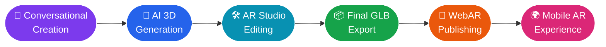
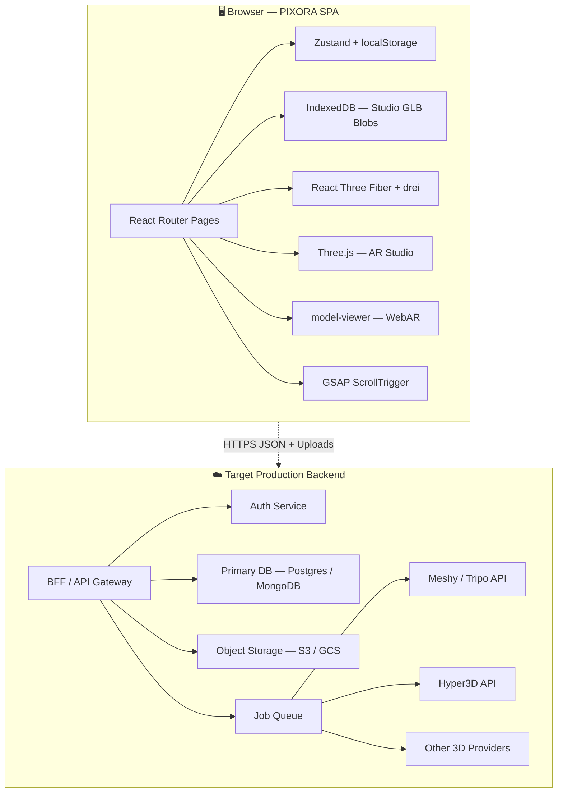
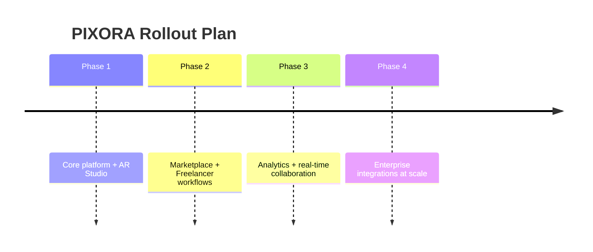

<div align="center">

<p align="center">
  
</p>

<a href="#"></a>

<br/>


<h3>🚀 <a href="#">Live Demo</a> &nbsp;|&nbsp; 🎥 <a href="#">Read the Features</a> &nbsp;|&nbsp; 📦 <a href="#">GitHub Repo</a> &nbsp;|&nbsp; 🧭 <a href="#">Architecture Docs</a></h3>

</div>

<br/>

## 🪄 What is PIXORA?

> **PIXORA** turns a sentence — or a single photo — into a **production-ready 3D model** you can edit right in your browser and **beam into the real world via WebAR**, in minutes, with zero installs and zero Blender tutorials.

<div align="center">

```
   💬 "a modern wooden armchair with cushions"
              │
              ▼
   🤖  AI 3D GENERATION  (Text-to-3D / Image-to-3D)
              │
              ▼
   🛠️  BROWSER AR STUDIO  (move · rotate · scale · brand it)
              │
              ▼
   📱  WEBAR PUBLISHING  (QR code · shareable link)
              │
              ▼
   ✨  YOUR PRODUCT, LIFE-SIZE, IN SOMEONE'S LIVING ROOM
```

</div>

**One idea → one platform → one shareable AR experience.** No specialist software. No physical prototypes. No five different tools stitched together with duct tape.

---

## 😩 The Problem

<table>
<tr>
<td width="50%" valign="top">

### The old way is broken
- 🧱 Blender / Maya / Unreal → powerful, but slow, expensive, **not beginner-friendly**
- 🧵 4–5 disconnected tools just to go from *idea* → *editable* → *hosted* → *published*
- 📵 No easy way for a customer to check a 3D model on **their own device**
- 🧑‍🎨 Human 3D modelers are in high demand but painfully limited supply
- 🖼️ Flat product photos never show real-world scale or fit

</td>
<td width="50%" valign="top">

### Why existing tools stop short
- AI image generators **stop at a flat image**
- Text-to-3D tools **stop at generation** — no editing, no AR, no sharing
- Professional 3D suites are **overkill** for a marketing team or solo founder
- Every stage — creation, editing, hosting, AR, commerce — lives in a **different product**

</td>
</tr>
</table>

<div align="center">

### 🧨 If product creation stays fragmented, businesses lose **time, money, and customer confidence.**

</div>

---

## 💡 The PIXORA Fix

<div align="center">



</div>

| ⚡ Faster Creation | 🌐 Zero Install | 📦 Production-Ready | 🔗 Instant Sharing | 🕶️ Real AR |
|:---:|:---:|:---:|:---:|:---:|
| Idea → 3D in minutes | Runs entirely in-browser | Optimized, exportable GLB | QR code or shareable link | True-to-scale product previews |

---

## 🧩 Core Capabilities

<table>
<tr>
<td width="33%" valign="top">

### 🎨 Creation Engine
- AI 3D Generation
- Text-to-3D
- Image-to-3D
- GLB Generation

</td>
<td width="33%" valign="top">

### 🛠️ AR Studio
- Load & transform GLB models
- Move · rotate · scale
- Add logos & extra 3D assets
- Live scene preview + export

</td>
<td width="33%" valign="top">

### 📡 WebAR & Distribution
- QR code publishing
- Shareable AR links
- Mobile browser AR (`<model-viewer>`)
- Reusable digital assets

</td>
</tr>
</table>

<details>
<summary><b>🛍️ Plus: Marketplace, Freelancer Hub & Human-in-the-loop refinement</b> — click to expand</summary>

<br/>

- **Marketplace** — browse/sell verified 3D assets (avatars, sneakers, vehicles, character suits) with pricing & ratings
- **Freelancer Hub** — hire vetted 3D artists for retopology, PBR materials, rigging, and bulk optimization work
- **Human + AI Collaboration** — AI does the heavy lifting; experts polish what matters

</details>

---

## ✨ Complete Feature Guide

PIXORA (ARdya) is an end-to-end AI-powered 3D and WebAR platform: start with a prompt or image, refine the resulting digital twin in the browser, and publish it as a mobile AR experience without an app download.

### 1. 🤖 AI 3D Generation Suite

- **Text-to-3D creation** — generate or discover models from natural-language prompts such as “vintage leather armchair” or “futuristic quadcopter.”
- **Image-to-3D reconstruction** — upload product photos, sketches, sneakers, figurines, or artwork and turn them into textured GLB assets.
- **AI Studio model selection** — choose generation modes with visible credit costs and provider-specific quality, topology, and texture trade-offs.
- **Asynchronous task workflow** — submit jobs, poll progress, extract thumbnails, cache assets, and keep generation history in the project workspace.
- **Human designer handoff** — send complex CAD, retopology, rigging, or finishing work to the Freelancer Hub when AI output needs specialist refinement.

### 2. 🎨 Interactive 3D Studio

- **Viewport navigation** — orbit, pan, zoom, focus, and inspect scenes with mouse, trackpad, and touch controls.
- **Transform gizmos** — translate, rotate, and scale models on individual axes or uniformly.
- **Scene composition** — combine multiple GLB assets into one scene and manage individual parts.
- **Brand decals** — upload transparent logos or graphics and position, scale, and orient them in the scene.
- **Real-world dimensions** — inspect model width, height, and depth in centimeters, inches, or feet for accurate AR placement.
- **Lighting and environments** — tune ambient and directional lighting, shadows, and environment reflections.
- **Motion tools** — use turntable and floating showcase animations alongside embedded model animations.
- **Studio AI Copilot** — ask for help with lighting, scale, scene setup, and model optimization without leaving the editor.
- **Export workflows** — prepare GLB/glTF assets for web, mobile AR, games, and downstream 3D tools.

### 3. 📱 Universal WebAR Experience

- **Zero-app AR** — open a shared model in a mobile browser on supported iOS and Android devices.
- **Camera passthrough** — use the device environment camera for an in-browser AR preview.
- **Placement and gestures** — place models in the scene, drag them, pinch to scale, and rotate them with touch gestures.
- **Interactive model controls** — support selectable parts, animation controls, and responsive mobile interactions.
- **Native viewer fallbacks** — connect to Model Viewer, WebXR-compatible flows, Android Scene Viewer, and Apple Quick Look where supported.

### 4. 🚀 Publishing and Sharing

- **Public AR routes** — publish projects through shareable AR and model URLs.
- **QR generation** — create scannable handoff links for packaging, posters, presentations, and desktop-to-mobile workflows.
- **Brand customization** — configure titles, descriptions, accent colors, and calls to action for published experiences.
- **GLB delivery** — stream or proxy model assets so shared experiences work across browser and mobile contexts.

### 5. 📊 Dashboard and Asset Management

- **Project library** — manage draft, generated, edited, and published projects.
- **Project actions** — open projects in Studio or AR Viewer, rename, duplicate, download, and share them.
- **Credit wallet** — track available credits, generation usage, and top-up flows.
- **Persistent project state** — synchronize project metadata, chat history, model URLs, transforms, interactions, and studio settings.

### 6. 🛒 Marketplace and Commerce

- **Interactive asset previews** — inspect 3D models before purchasing or listing them.
- **Category browsing** — discover assets across vehicles, furniture, architecture, characters, electronics, fashion, nature, and sci-fi.
- **Cart workflow** — collect marketplace items and proceed through the checkout experience.
- **Creator listings** — upload assets, add descriptions, tags, pricing, licensing details, and model metadata.

### 7. 🤝 Freelancer and 3D Talent Hub

- **Designer directory** — discover 3D artists, AR specialists, character animators, and optimization experts.
- **Artist profiles** — review skills, rates, portfolio information, and creator details.
- **Project briefs** — submit custom project requirements for modeling, retopology, materials, rigging, and AR optimization.

### 8. 🎓 Learning and Community

- **Learn curriculum** — documentation-style lessons covering 3D foundations, WebAR, spatial computing, materials, and mobile performance.
- **Progress-oriented content** — organize learning into structured sections with practical links and implementation guidance.
- **Community showcase** — share creator work, discover projects, and exchange feedback around 3D and AR experiences.

### 9. 🌱 Sustainability and Digital Twins

- **Digital-first prototyping** — use AR previews to reduce reliance on physical samples and early-stage shipping.
- **Sustainability content** — explain how virtual models can support lower-waste design, review, and merchandising workflows.
- **Impact narrative** — connect digital twins with more efficient product validation and fewer unnecessary physical iterations.

### 10. 🛡️ Enterprise Backend and Cloud Architecture

- **Modular REST API** — separate routes, controllers, models, validators, and authentication middleware.
- **Secure identity flows** — JWT sessions, bcrypt password hashing, email verification, and password reset workflows.
- **Credit enforcement** — validate generation requests and maintain server-side credit balances.
- **Dual asset strategy** — support local GLB caching and provider/cloud URLs for resilience on ephemeral deployments.
- **Operational visibility** — request logging, health checks, task history, and integration tests support reliable operation.

### Feature Summary

| Core Pillar | Key Capabilities |
| :--- | :--- |
| **AI Generation** | Text-to-3D, image-to-3D, asynchronous jobs, credit-aware generation, human refinement |
| **3D Studio** | Gizmos, scene fusion, decals, real-world scale, lighting, motion, AI Copilot |
| **WebAR** | Browser camera preview, placement, gestures, animations, Model Viewer and native fallbacks |
| **Publishing** | Share links, QR codes, branded AR pages, GLB delivery |
| **Marketplace** | Interactive previews, categories, cart, creator listings |
| **Talent and Learning** | Freelancer briefs, artist discovery, WebAR curriculum, community showcase |
| **Impact** | Digital twins, virtual prototyping, lower-waste product review workflows |

---

## 🏗️ Architecture

<div align="center">



</div>

**Today:** text/image-to-3D generation runs live in the browser via the Tripo API. **Tomorrow:** every generative call moves behind an authenticated, queued backend with object storage and provider fallback — same frontend, real infrastructure underneath.

---

## 🧪 Prototype in Action

<div align="center">

| 🧍 AR Studio (Three.js) | 🛍️ Marketplace | 📱 Scan → View in AR | 🧑‍💻 Freelancer Hub |
|:---:|:---:|:---:|:---:|
| Load, transform & export GLB | Verified 3D asset catalog | Real-world scale preview | Hire experts on demand |

</div>

> **📲 Scan the QR code → the 3D model appears life-size in your own room, through your phone browser. No app to install.**

---

## 🛠️ Complete Technology Stack

PIXORA (ARdya) is built as a browser-first 3D creation and WebAR platform. The stack below reflects the technologies currently used by the frontend and backend manifests, plus the production services configured in `backend/render.yaml`.

### 1. 🎨 Frontend Architecture & UI

- **React 19 (`react`, `react-dom`)** — component-based UI and concurrent rendering patterns.
- **TypeScript 5.8 (`typescript`)** — strict type checking for components, state, and API contracts.
- **Vite 6 (`vite`, `@vitejs/plugin-react`)** — development server, HMR, and production bundling.
- **Tailwind CSS v4 (`tailwindcss`, `@tailwindcss/vite`)** — responsive dark-mode and glassmorphic styling.
- **Zustand 5 (`zustand`)** — global state for authentication, credits, projects, marketplace data, and studio state.
- **React Router DOM 7 (`react-router-dom`)** — SPA navigation for Studio, AR Viewer, Dashboard, Marketplace, Learn, and related routes.
- **Motion and interaction** — Framer Motion / Motion v12 and GSAP v3 for transitions, scroll timelines, staggered reveals, and layout animation.
- **UI utilities** — Lucide React icons, `clsx`, `tailwind-merge`, and `qrcode`.

### 2. 🧊 3D Graphics, WebGL & WebAR

- **Three.js (`three`, `@types/three`)** — real-time rendering, cameras, lights, materials, transforms, and export workflows.
- **React Three Fiber 9 (`@react-three/fiber`)** — declarative Three.js integration for React.
- **Drei (`@react-three/drei`)** — reusable controls, helpers, environments, and scene utilities.
- **Google Model Viewer (`@google/model-viewer`)** — mobile AR entry points through WebXR, Scene Viewer, and Quick Look-compatible model flows.
- **Custom interactive AR viewer** — camera passthrough, model placement, touch gestures, interaction targets, animation controls, and mobile-friendly controls implemented in the application.
- **Mesh editing and physics** — `three-bvh-csg` for browser-side Boolean operations and `@react-three/cannon` for rigid-body physics.

### 3. ⚙️ Backend & REST API

- **Node.js** — asynchronous JavaScript runtime for the API service.
- **Express 4 (`express`)** — REST endpoints for authentication, projects, credits, generation tasks, chat, freelancer applications, and asset delivery.
- **Middleware** — CORS, Morgan request logging, Dotenv configuration, JSON/urlencoded body parsing, and request IDs.
- **Communication** — Nodemailer for transactional email flows such as verification and password reset.
- **HTTP clients** — Axios and `node-fetch` for provider APIs and remote asset requests.

### 4. 🗄️ Database & Asset Storage

- **MongoDB with Mongoose 8** — users, projects, chat messages, freelancer data, and Tripo task records.
- **Local GLB storage** — uploaded AR models are stored under the backend upload area for local development and persistent hosts.
- **Public share routes** — project sharing and model streaming endpoints provide browser and mobile AR access.
- **Cloud deployment fallback** — project model URLs can preserve provider/cloud links when local filesystem storage is unavailable on ephemeral hosts.

### 5. 🤖 AI, 3D Generation & External APIs

- **Tripo 3D API** — authenticated text-to-3D and image-to-3D task creation, task polling, task history, and deletion.
- **Google Gemini (`@google/genai`)** — prompt assistance and in-studio AI chat integrations.
- **Meshy compatibility** — legacy Meshy model URLs and proxy handling remain supported for existing projects and generated assets.
- **Provider-ready API design** — generation controllers and task models isolate provider requests from the rest of the application, allowing additional engines to be added without changing the Studio UI.

> **Note:** Provider model names, credit costs, and availability are configured by the connected generation service and can change independently of the frontend release.

### 6. 📐 3D File and Media Processing

- **GLB/glTF workflows** — browser-side loading, transformation, preview, export, and WebAR publishing.
- **Sharp (`sharp`)** — image conversion and WebP preparation for image-to-3D uploads.
- **QR publishing** — `qrcode` generates scannable links for mobile AR experiences.

### 7. 🔒 Security, Authentication & Validation

- **JSON Web Tokens (`jsonwebtoken`)** — stateless API authentication.
- **Bcrypt.js (`bcryptjs`)** — salted password hashing.
- **DOMPurify + JSDOM (`dompurify`, `jsdom`)** — sanitization of user-controlled authentication and project content.
- **Express Validator (`express-validator`)** — request schema validation for authentication payloads.
- **Environment configuration** — secrets and service URLs are supplied through environment variables and are not committed to the repository.

### 8. 🧪 Testing & Code Quality

- **Jest 29 (`jest`)** — backend unit and integration test runner.
- **Supertest (`supertest`)** — HTTP assertions for Express routes.
- **MongoDB Memory Server** — isolated MongoDB instances for integration tests.
- **TypeScript compiler (`tsc --noEmit`)** — frontend type checking via `npm run lint`.
- **Vite production build** — validates the deployable frontend bundle via `npm run build`.

### 9. ☁️ DevOps, Deployment & Cloud Infrastructure

- **Render (`backend/render.yaml`)** — declarative deployment configuration for the Node.js backend.
- **MongoDB Atlas-compatible configuration** — production database connection is supplied through `MONGO_URI`.
- **Git and GitHub** — source control, branch tracking, and deployment integration.
- **Vite preview/static hosting** — the frontend can be built and served by any static hosting provider.

### Tech Stack at a Glance

| Layer | Primary Technologies |
| :--- | :--- |
| **Frontend** | React 19, TypeScript 5.8, Vite 6, Zustand 5, React Router DOM 7 |
| **Styling & Motion** | Tailwind CSS v4, Framer Motion, Motion, GSAP |
| **3D & WebAR** | Three.js, React Three Fiber, Drei, Model Viewer, WebXR-compatible flows |
| **Backend & API** | Node.js, Express 4, REST APIs, Axios, node-fetch |
| **Database** | MongoDB, Mongoose 8 |
| **AI Generation** | Tripo 3D API, Gemini API, Meshy-compatible asset workflows |
| **Media & Export** | GLB/glTF, Sharp, QRCode, three-bvh-csg |
| **Security** | JWT, Bcrypt.js, DOMPurify, Express Validator |
| **Testing & Deployment** | Jest, Supertest, MongoDB Memory Server, Render, Git/GitHub |

```bash
# Get PIXORA running locally
git clone <repo-url> pixora && cd pixora
npm install
npm run dev
# → http://localhost:5173
```

---

## 📊 Why PIXORA Wins

<div align="center">

| Feature | 😖 Traditional Workflow | 🚀 PIXORA |
|---|:---:|:---:|
| AI Generation | Separate tool | ✅ Integrated |
| 3D Editing | Specialist software (Blender/Maya) | ✅ Browser-based |
| WebAR | Separate setup & app | ✅ Built-in, QR-ready |
| Marketplace | Separate platform | ✅ Integrated |
| Human Experts | Separate hiring pipeline | ✅ Integrated hub |

</div>

---

## 🌍 Who Needs This

<table>
<tr>
<td width="50%" valign="top">

**🎯 Target Market**
- E-commerce & retail
- Furniture & interior design
- Fashion & footwear brands
- Automotive companies
- Advertising agencies
- Product designers & educators

</td>
<td width="50%" valign="top">

**💰 Business Value**
- Cuts physical sample costs
- Boosts product visualization & confidence
- Increases customer engagement
- Assets are reusable across every channel
- Kills dependency on specialist 3D tools

</td>
</tr>
</table>

---

## 🗺️ Roadmap

<div align="center">



</div>

**On the horizon:** real-time conversational AI co-pilot · more generation providers · voice + multilingual support · AR engagement analytics · embedded e-commerce viewers · custom domains · marketplace payments & licensing.

---

## 🏆 Innovation Highlights

| # | Innovation | Why It Matters |
|---|---|---|
| 1 | **Complete Text-to-AR Workflow** | Conversation → concept → 3D → editing → AR → sharing, in one connected pipeline |
| 2 | **Browser-Based AR Studio** | Full Three.js editor — no desktop software, ever |
| 3 | **Human + AI Collaboration** | AI speed, meets expert-grade polish on demand |

---

## 👥 Team 0xDEADCODE

<div align="center">

| Role | Name |
|---|---|
| 🧑‍✈️ Team Lead | Kishan Nishad |

**📧 knishad0004@gmail.com** &nbsp;|&nbsp; **Problem Statement:** Open Innovation — PS #6 Wildcard Innovation Challenge

</div>

---

<div align="center">

## ✨ From Idea → Interactive 3D Product Experience

### **Create → Edit → Refine → Publish → Experience**

**AI-powered 3D creation + Browser-based AR Studio + WebAR + Human Expertise**

<br/>

[](#)
[](#)


### Made with 🔥 by Kishan Nishad — **PIXORA**

</div>
# codexDTU
